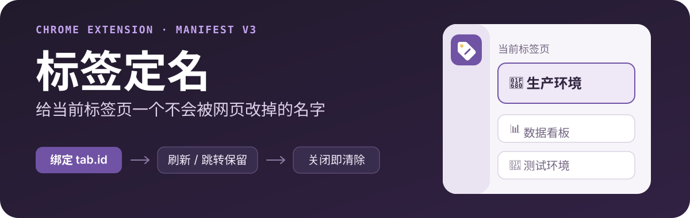
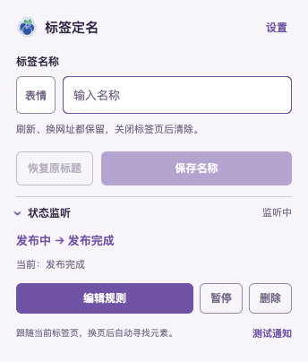
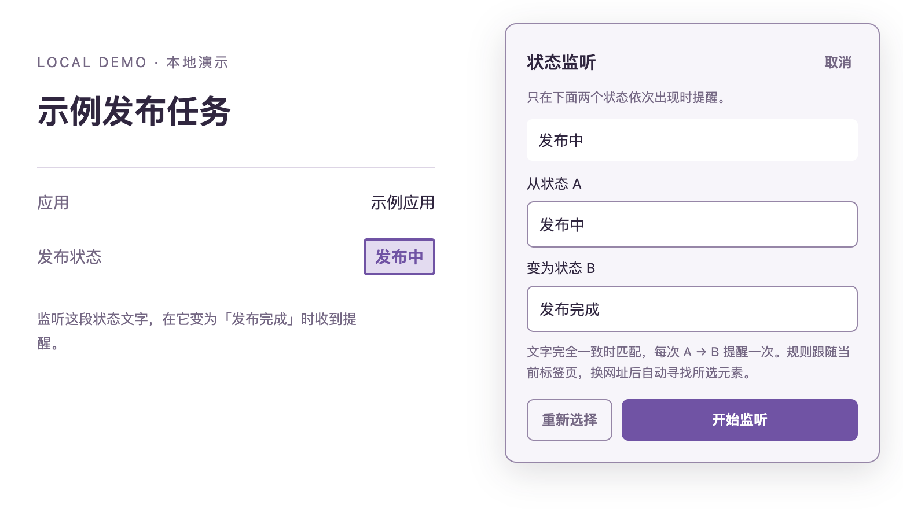
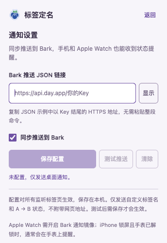

<p align="center">
  
</p>

<p align="center">
  一个 Chrome 扩展：<strong>名字跟随标签页，状态变化有提醒。</strong><br>
  刷新、跳转后保留名称；每次 A → B 都能提醒，可通过 Bark 同步到手机与 Apple Watch。
</p>

<p align="center">
  <a href="#安装">安装</a> ·
  <a href="#给标签页定名">标签定名</a> ·
  <a href="#状态变化时提醒你">状态提醒</a> ·
  <a href="#bark-同步到手机与-apple-watch">Bark 推送</a> ·
  <a href="#隐私与权限">隐私与权限</a>
</p>

<p align="center">
  <picture>
    <source media="(prefers-color-scheme: dark)" srcset="./assets/readme/popup-dark.png">
    
  </picture>
</p>

## 安装

支持 **Chrome 120+**，通过开发者模式加载。扩展本身无需安装依赖或构建。

```bash
git clone https://github.com/msunx/tab-name-lock.git
```

也可以[下载 ZIP](https://github.com/msunx/tab-name-lock/archive/refs/heads/main.zip) 后解压。

1. 打开 `chrome://extensions`，开启「开发者模式」。
2. 点击「加载已解压的扩展程序」，选择包含 `manifest.json` 的项目目录。
3. 将「标签定名」固定到工具栏，打开普通网页后点击扩展图标。

macOS 快捷键：<kbd>Option</kbd> + <kbd>Shift</kbd> + <kbd>R</kbd>。其他平台为 <kbd>Alt</kbd> + <kbd>Shift</kbd> + <kbd>R</kbd>，可在 `chrome://extensions/shortcuts` 修改。

更新代码后，在扩展管理页点击「重新加载」，再刷新业务页面。**扩展重新加载会清空本次会话的名称和监听规则，需要重新配置；已保存的 Bark 配置会保留。**

## 给标签页定名

在扩展中输入名称，选择一个 Emoji，点击「保存名称」。例如，把几个相似的页面分别命名为 `🚀 演示环境`、`🧪 测试环境`、`📚 参考文档`。

- 同一个网址打开多次，可以分别命名；每个名称只属于自己的标签页。
- 刷新、前进后退、换网址，名称仍然保留；网页自行更新标题时也会恢复自定义名称。
- 内置 96 个常用 Emoji，也支持粘贴其他完整表情；点击「恢复原标题」即可取消定名。

## 状态变化时提醒你

选中网页里的状态文字，例如「发布中」，设置目标状态「发布完成」。当实际观察到这次转换时，Chrome 会发送系统通知；点击通知可返回对应标签页。

<p align="center">
  
</p>

1. 展开扩展中的「状态监听」，点击「选择元素」。
2. 在网页上点击需要监听的文字。高亮选择不会触发原网页的点击操作；按 Esc 可取消。
3. 确认当前文字作为状态 A，填入状态 B，点击「开始监听」。

每个标签页可配置一条持续监听的规则，支持编辑、暂停、继续和删除。**规则跟随当前标签页**：换网址后自动寻找所选元素，找不到时显示「等待元素」，找到后继续。切到其他标签页时，只要原页面仍在运行和更新，监听会继续。

状态去除首尾空白、合并连续空白与换行后，必须与元素的整段可见文字完全一致。`发布成功` 与 `发布完成` 是两个不同的状态，请按页面实际文字填写。

| 观察到的变化 | 提醒结果 |
| --- | --- |
| 发布中 → 发布完成 | 通知一次 |
| 发布中 → 失败 → 发布完成 | 不通知 |
| 首次看到发布完成，或文字始终不变 | 不通知 |
| 发布中 → 发布完成 → 发布中 → 发布完成 | 通知两次 |

换页、手动继续监听或保存修改后的规则时，会从当前文字重新开始，避免把不同页面的状态拼成一次提醒。颜色、样式和装饰性图标的变化不作为匹配条件；无法唯一定位元素时显示「需重新选择」。

## Bark 同步到手机与 Apple Watch

通知配置藏在右上角的「设置」中，对所有监听标签页生效。

<p align="center">
  <picture>
    <source media="(prefers-color-scheme: dark)" srcset="./assets/readme/bark-settings-dark.png">
    
  </picture>
</p>

1. 在 iPhone 安装 Bark，从 App 的推送示例中取得设备 `device_key`。
2. 点击扩展的「设置」，填写 `https://api.day.app/你的真实device_key`；自建服务也使用以设备 Key 结尾的 HTTPS 地址。
3. 点击「测试推送」检查接收效果，保留「同步推送到 Bark」勾选并点击「保存配置」。测试成功不会自动保存。

如果复制到的是 `POST https://api.day.app/push` 的 JSON 示例，将正文中的 `device_key` 真实值放到上述地址末尾即可。输入框接收**带 Key 的完整地址**，无需粘贴 `/push` 地址、整段 curl 或 JSON 正文；通知标题、正文和分组由插件生成。

之后每次监听到 A → B，扩展会同时发送桌面通知与 Bark 推送。两路通知独立处理，某一路失败不阻断另一路；失败信息显示在状态监听中。主界面的「测试通知」检查桌面通知，设置页的「测试推送」检查 Bark。

推送链接默认遮蔽，点击「显示」可临时查看。配置仅保存在本机，重启浏览器或重新加载扩展后仍保留；取消勾选并保存可停用同步，点击「清除」可删除配置。

### Apple Watch 如何接收

Apple Watch 需在 iPhone 的 Watch App 中开启 Bark 通知镜像。iPhone 解锁使用时通常由手机提醒，锁屏且手表已解锁时通常由手表提醒，具体受设备连接与专注模式设置影响。

### 更新后提示「标签页已失效」

更新本地文件后，Chrome 可能已读到新设置页面，但后台仍在运行旧版代码。这时需要重新加载整个扩展，关闭并重开弹窗无效。

新版会提示「扩展后台尚未更新」，并提供「打开扩展管理」按钮；也可直接打开 `chrome://extensions`，找到「标签定名」并点击「重新加载」，再打开设置。**现有名称和监听规则会清除，已保存的 Bark 配置保留。**

## 名称与规则会保留多久

| 操作 | 标签名称 | 状态监听 |
| --- | --- | --- |
| 同一网址刷新 | 保留 | 重新寻找元素，接续最近状态 |
| 换网址或站内路由 | 保留 | 重新寻找元素，从当前状态开始 |
| 移动到其他 Chrome 窗口 | 保留 | 保留 |
| 复制标签页或新开相同网址 | 不继承 | 不继承 |
| 关闭对应标签页或窗口 | 清除 | 清除 |
| 重启 Chrome、更新或重新加载扩展 | 清除 | 清除 |

Bark 配置独立保存在本机，不随标签页或浏览器关闭而清除，可在设置页停用或删除。

## 隐私与权限

扩展无需账号，没有统计分析或远程代码。名称、规则、最近状态和通知关联保存在浏览器会话存储中；系统通知会显示标签名称或网页标题，以及配置的 A → B 文字。

Bark 同步默认未配置。开启后，自定义标签名与配置的 A → B 状态会通过 HTTPS 发送到你填写的 Bark 服务；没有自定义名称时使用「标签定名」，不附带网页原标题、网址或其他页面内容。推送链接包含设备 Key，仅保存在本机扩展存储中，不使用浏览器账号同步，页面内容脚本也不能读取此配置。网络错误不会显示完整链接或服务返回的敏感正文。

<details>
<summary>查看各项权限的用途</summary>

| 权限 | 用途 |
| --- | --- |
| `storage` | 保存本次会话中的名称、规则和最近状态；在本机保留 Bark 配置 |
| `tabs` | 识别标签页，处理移动、关闭和通知点击后的返回 |
| `scripting` | 为已打开的网页补充标题保持与元素选择脚本 |
| `notifications` | 发送状态提醒和测试通知 |
| `webNavigation` | 识别刷新和路由变化，拒绝旧页面的延迟消息 |
| HTTP / HTTPS 网站访问权限 | 在普通网页保持标题、读取所选状态元素，并向配置的 HTTPS Bark 地址发送推送 |

</details>

## 使用边界

- **页面类型**：支持普通 HTTP / HTTPS 网页。Chrome 内置页面、扩展商店、部分查看器和本地文件不支持；回到支持的网页后会恢复已保存的名称，并重新寻找监听元素。
- **状态来源**：支持主文档里的可见文字，不支持 iframe、Shadow DOM、Canvas 或输入框的值。扩展不自动刷新网页，也不查询网站的业务接口。
- **页面运行**：电脑休眠、标签页被冻结或丢弃、网页停止更新时，无法持续观察。复杂的 DOM 重建若无法还原中间状态，会从当前状态重新开始，可能漏掉该次转换。
- **通知显示**：可先点「测试通知」。Chrome 和系统需要允许通知；macOS 专注模式可能影响横幅显示。
- **标题与访问权限**：导航期间可能短暂显示网页原标题。若将网站访问权限设为「点击时允许」，自动保持名称和监听也会受到限制。

## 开发与验证

使用 Manifest V3 和原生 JavaScript。仅运行浏览器验收时需要安装开发依赖：

```bash
npm install
npx playwright install chromium
npm run verify:browser
npm run verify:popup
npm run verify:update
```

`verify:browser` 检查标签隔离、名称保持、元素选择、状态转换、换页恢复、规则清理，以及 Bark 配置、JSON 请求、两路通知隔离与配置访问限制；使用本地演示页和通知/推送 API 替身，不访问真实业务系统。`verify:popup` 检查 Chrome 工具栏弹窗、Bark 设置页、Emoji 选择与保存操作。系统通知横幅及手机、手表的实际接收效果需要在本机另行确认。

`verify:update` 在临时扩展副本中复现新设置页搭配旧后台，检查重新加载提示、扩展管理入口，以及重新加载后的配置保留与恢复。

## 最近更新

**1.5.1**：新增独立通知设置与 Bark 同步推送，支持测试、停用、清除和本机保留配置；增加旧后台未重新加载时的明确提示与扩展管理入口。
